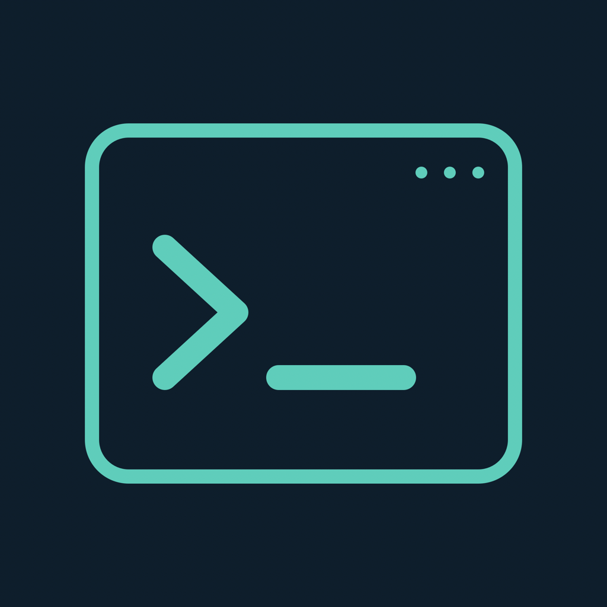
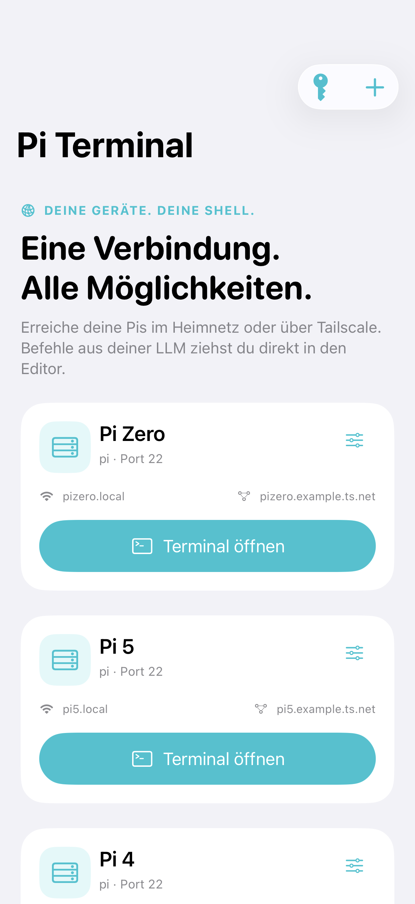
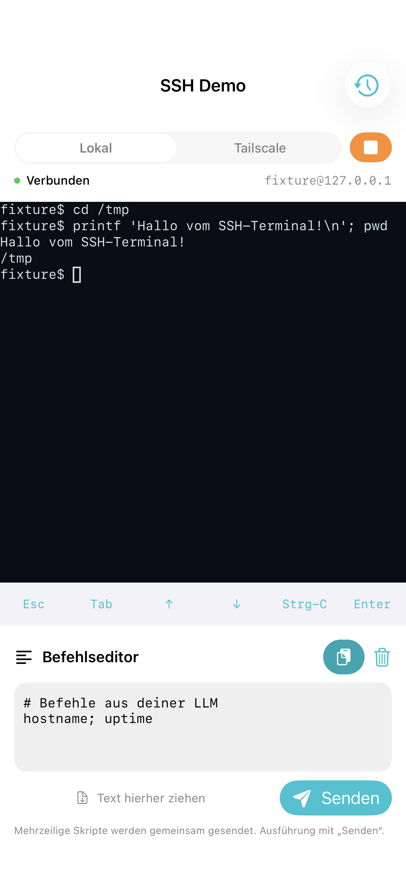

<p align="center"></p>
<h1 align="center">Pi Terminal</h1>
<p align="center">Ein nativer SSH-Client für iPhone — mit Face ID, Tailscale und einem Editor für LLM-Befehle.</p>

Pi Terminal verbindet sich mit deinen Raspberry Pis und anderen SSH-Geräten im lokalen Netz oder über Tailscale. Befehle aus ChatGPT, anderen LLMs oder Notizen lassen sich einfügen oder per Drag-and-drop vorbereiten und bewusst senden.

**Version 1.0.0 · iOS 17+ · SwiftUI · MIT**

## Ein Blick in die App

| Geräte und Verbindungen | Terminal und Befehlseditor |
|---|---|
|  |  |

Die Bilder zeigen die native App im iPhone-Simulator: links erfundene Beispielprofile, rechts eine echte SSH-Verbindung zum lokalen Testserver. Sie enthalten keine persönlichen Geräteadressen oder Zugangsdaten.

## Funktionen

- Geräteprofile mit getrennten Adressen für **Lokal** und **Tailscale**.
- Dauerhafte Shell mit Terminalfarben, Scrollback, Cursorsteuerung, `cd` und Shell-Variablen.
- Mehrzeiliger Befehlseditor mit Einfügen, Drag-and-drop und Aufbereitung eines einzelnen Markdown-Codeblocks.
- Eigener Ed25519-Schlüssel im iPhone-Schlüsselbund, bei jeder Verbindung durch **Face ID** freigegeben.
- Tailscale SSH einschließlich zusätzlicher Browser-Freigabe; alternativ normale SSH-Passwortanmeldung.
- Prüfung und Speicherung der Server-Schlüssel. Änderungen werden vor einer neuen Anmeldung angezeigt.
- Sitzungsverlauf für die letzten 30 über den Editor gesendeten Befehle.

## Installieren

1. Das Repository klonen und `SSHClient.xcodeproj` in **Xcode 26.1 oder neuer** öffnen.
2. Das Schema **SSHClient** wählen. Unter **Signing & Capabilities** dein eigenes Entwicklerteam und gegebenenfalls eine eigene Bundle-ID eintragen.
3. Dein iPhone als Ziel wählen und mit **Run** installieren. Face ID und Gerätecode müssen eingerichtet sein.
4. In der App bei einem Pi **Gerät einrichten** wählen: Linux-Benutzer, Port und lokale Adresse und/oder Tailscale-Adresse angeben.
5. Über den Schlüsselknopf den **öffentlichen iPhone-Schlüssel** anzeigen und auf dem Zielgerät hinterlegen. Siehe [Server einrichten](docs/BEDIENUNG.md#server-einrichten).
6. **Terminal öffnen**, **Lokal** oder **Tailscale** wählen und den Blitz antippen. Beim ersten Kontakt den Server-Fingerabdruck vergleichen und bestätigen.

Die öffentliche Version enthält drei leere Profile für Pi Zero, Pi 5 und Pi 4. Adressen, Passwörter, private Schlüssel und persönliche Signierung sind nicht enthalten. Die App richtet selbst kein VPN ein: Für Tailscale muss die Tailscale-App auf dem iPhone verbunden sein.

## Ersten Befehl senden

Im Befehlseditor eingeben oder einfügen:

```bash
hostname; uptime
```

Mit **Senden** ausführen. Das Terminal zeigt Gerätename und Laufzeit. Mehrzeilige Skripte werden gemeinsam an die aktuelle Shell bzw. Vordergrundanwendung gesendet. **Strg-C** unterbricht einen laufenden Prozess.

## Dokumentation

- [Bedienung mit Bildern](docs/BEDIENUNG.md): Einrichtung, Face ID, Tailscale, LLM-Befehle und Fehlerbehebung.
- [Entwickeln und Tests](docs/ENTWICKLUNG.md): Build, SSH-Testserver und reproduzierbare Screenshots.
- [Prüfstand](docs/VALIDIERUNG.md): automatische Prüfungen und sechs bestätigte Geräteverbindungen.
- [Versionshinweise](CHANGELOG.md).

## Grenzen und Speicherung

Die App hält Verbindungen im Vordergrund. iOS kann sie im Hintergrund unterbrechen; es gibt keine automatische Wiederholung von Befehlen. Beim Verlassen der Terminalansicht wird die Verbindung getrennt. Editor, Terminalausgabe und Verlauf bleiben nur während der Sitzung im Arbeitsspeicher.

Geräteprofile liegen lokal in einer geschützten JSON-Datei. Passwörter und der eigene SSH-Schlüssel liegen im iOS-Schlüsselbund; der Schlüssel ist an dieses Gerät und die aktuelle biometrische Registrierung gebunden. Für die SSH-Signatur wird er nach biometrischer Freigabe im Arbeitsspeicher der App verwendet. Es handelt sich nicht um einen Secure-Enclave-Signaturschlüssel.

Der Import fremder privater Schlüssel, Keyboard-Interactive/2FA, SFTP und eine automatische Schlüsselwiederherstellung sind derzeit nicht implementiert. Serverseitige Zwischenablagezugriffe und das Öffnen von Links aus Terminalausgaben sind deaktiviert. Tailscale-Freigaben werden separat als Link zur offiziellen Anmeldeseite angeboten.

## Bibliotheken und Lizenz

[Citadel 0.12.1](https://github.com/orlandos-nl/Citadel) übernimmt SSH, [SwiftTerm 1.20.0](https://github.com/migueldeicaza/SwiftTerm) die VT100/Xterm-Anzeige. Die lokale Citadel-Fassung enthält kleine, [dokumentierte Anpassungen](Vendor/Citadel/LOCAL_CHANGES.md) für Authentifizierung, Banner und Abbruch. Die Abhängigkeiten sind über `Package.resolved` festgehalten.

Eigener Anwendungscode: [MIT](LICENSE). Abhängigkeiten behalten ihre jeweiligen Lizenzen; die Hinweise liegen in [ThirdPartyNotices.txt](SSHClient/ThirdPartyNotices.txt) und bei den vendorten Quellen.
