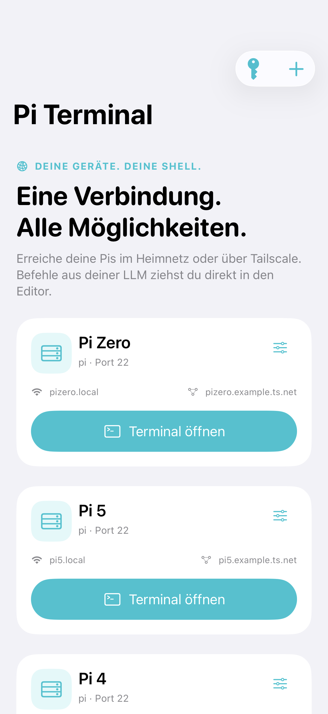
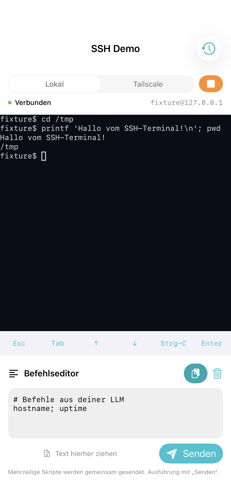

# Pi Terminal bedienen

## Geräte einrichten



Pi Zero, Pi 5 und Pi 4 stehen als leere Profile bereit. Über **Gerät einrichten** bzw. den Reglerknopf lassen sie sich bearbeiten. **+** fügt weitere Geräte hinzu. Langes Drücken auf eine Gerätekarte öffnet Bearbeiten und Löschen.

| Feld | Bedeutung | Beispiel |
|---|---|---|
| Name | Frei wählbare Bezeichnung | Pi 5 |
| Benutzer | Linux-Benutzer auf dem Zielgerät | pi |
| SSH-Port | Üblicherweise 22 | 22 |
| Lokale Adresse | Hostname oder IP im Heimnetz | pi5.local |
| Tailscale-Adresse | Tailscale-IP oder MagicDNS-Name | Dein eigener Gerätename aus Tailscale |
| Anmeldung | iPhone-Schlüssel mit Face ID oder Passwort | iPhone-Schlüssel |

Mindestens eine Adresse muss eingetragen sein. Nur Hostname oder IP eingeben, ohne `ssh://`, Benutzer oder Port. IPv6-Adressen ohne eckige Klammern eingeben. Lokale und Tailscale-Adresse verwenden denselben eingetragenen Port.

## Server einrichten

### Eigener iPhone-Schlüssel

Die App erzeugt einen eigenen Ed25519-Schlüssel auf dem iPhone. Der Schlüsselknopf auf der Startseite zeigt ausschließlich den öffentlichen Teil. Diesen über **Öffentlichen Schlüssel teilen** übernehmen und einmal auf dem Zielgerät in `~/.ssh/authorized_keys` des vorgesehenen Linux-Benutzers hinterlegen.

Beispiel auf dem Zielgerät, nach Anmeldung über deinen bestehenden Zugang:

```sh
install -d -m 700 ~/.ssh
printf '%s\n' 'HIER_DEN_VOLLSTAENDIGEN_OEFFENTLICHEN_SCHLUESSEL_EINSETZEN' >> ~/.ssh/authorized_keys
chmod 600 ~/.ssh/authorized_keys
```

Den Platzhalter vollständig durch die Zeile ersetzen, die mit `ssh-ed25519` beginnt. Bestehende Schlüssel beibehalten. Der private iPhone-Schlüssel wird nicht auf den Server kopiert.

Wenn der Server Quelladressen mit `AllowUsers`, einer Firewall oder Tailscale-Regeln begrenzt, muss auch das iPhone zugelassen sein. Die App ändert diese Regeln nicht. Die optionalen [Einrichtungsskripte](ENTWICKLUNG.md#optionale-einrichtungsskripte) werden ausschließlich manuell ausgeführt.

### Face ID

Vor einer Schlüsselanmeldung fordert iOS die biometrische Freigabe an. Die App nutzt `deviceOwnerAuthenticationWithBiometrics`; der Schlüsselbund-Eintrag ist durch `biometryCurrentSet` und `WhenPasscodeSetThisDeviceOnly` geschützt. Es gibt für diesen Schlüssel keinen automatischen Passwort-Fallback.

Bei einem unbekannten Server kommt die Server-Schlüsselprüfung hinzu. Nach deren Bestätigung kann Face ID erneut angefordert werden. Nach einer Änderung der Face-ID-Registrierung kann der bisherige Schlüssel unzugänglich sein. Eine automatische Rücksetzung/Wiederherstellung ist in Version 1.0.0 nicht enthalten.

### Optionales Passwort

In den Geräteeinstellungen **Passwort** wählen und das Linux-SSH-Passwort eingeben. Es wird lokal im Schlüsselbund gespeichert. Das ist nicht das Tailscale-Kontopasswort. Der Server muss Passwortauthentifizierung erlauben.

## Verbinden

1. **Terminal öffnen**.
2. **Lokal** oder **Tailscale** wählen.
3. Den Blitz antippen und Face ID bzw. die konfigurierte Anmeldung abschließen.
4. Beim ersten Kontakt den Server-Fingerabdruck auf dem Zielgerät vergleichen.

Die App zeigt einen passenden Prüfpfad für den verwendeten Server-Schlüssel an, beispielsweise:

```sh
sudo ssh-keygen -lf /etc/ssh/ssh_host_ed25519_key.pub
```

Lokal- und Tailscale-Endpunkt werden getrennt gespeichert. Der Schalter für den Verbindungsweg ist während einer Verbindung gesperrt. Das Stoppsymbol trennt die Sitzung.

## Tailscale

Auf dem iPhone muss die Tailscale-App bereits verbunden sein. Pi Terminal verwendet diesen vorhandenen Netzwerkweg.

- Bei normalem OpenSSH über Tailscale wird der iPhone-Schlüssel oder das eingetragene SSH-Passwort verwendet.
- Bei **Tailscale SSH** erfolgt die Serveranmeldung über die VPN-Identität; die App fordert vorher weiterhin Face ID für den gewählten iPhone-Schlüssel an.
- Wenn Tailscale eine zusätzliche Identitätsprüfung verlangt, erscheint **Bei Tailscale bestätigen**. Die offizielle Anmeldeseite öffnet sich innerhalb der App. Nach der Freigabe die Browseransicht schließen.
- Für diese SSH-Anmeldung stehen bis zu 120 Sekunden zur Verfügung. Nach einem Ablauf erneut verbinden.

Die App verändert keine Tailscale-Zugriffsregeln und ersetzt keine erforderliche Kontofreigabe. Hintergrundwechsel oder Netzwechsel können die Sitzung auf iOS unterbrechen.

## Befehle und LLM-Skripte



Der Editor unterhalb des Terminals ist zum Prüfen und Bearbeiten von Text gedacht. Eingefügter oder abgelegter Text wird dort vorbereitet. Erst **Senden** überträgt ihn samt abschließendem Enter an die aktive Shell.

### Einfügen und Drag-and-drop

- Text direkt in den Editor einfügen oder den systemeigenen Einfügeknopf verwenden.
- Text aus einer anderen App in den Editor bzw. auf **Text hierher ziehen** ziehen. Auf dem iPhone den Text mit einem Finger halten und mit einem zweiten Finger die App wechseln. Die Quell-App muss Text-Drag unterstützen.
- Über das Einfügen-Menü des Terminals eingefügter Text wird ebenfalls in den Editor übernommen.
- **Leeren** entfernt den Editorinhalt. Nach dem Senden bleibt er verfügbar; erneutes Senden führt ihn erneut aus.

Ein einzelner vollständiger Markdown-Codeblock wird von seinen äußeren Markierungen befreit. Mehrere Codeblöcke oder begleitende Erklärungen vor dem Senden manuell bereinigen. Unsichtbare Steuerzeichen außer Zeilenumbrüchen und Tabs werden beim Editorversand abgewiesen.

Mehrzeilige Skripte einschließlich Here-Documents bleiben erhalten. Wenn die Shell Bracketed Paste aktiviert hat, wird es verwendet. Befehle gehen an die aktuelle Vordergrundanwendung: Ein laufender Passwortdialog oder Texteditor empfängt daher ebenfalls diese Eingaben.

### Terminal und Verlauf

Die Shell bleibt während der Verbindung bestehen: `cd` und gesetzte Variablen wirken auch für spätere Eingaben. Direktes Tippen im Terminal ist möglich. Die Tastenleiste bietet **Esc**, **Tab**, **↑**, **↓**, **Strg-C** und **Enter**.

Über das Uhrsymbol öffnet sich der Verlauf der letzten 30 Editorbefehle dieser Sitzung. Antippen übernimmt einen Eintrag in den Editor. Direkt im Terminal eingegebene Passwörter oder Befehle werden dort nicht mitgeschrieben.

## Fehlerbehebung

| Problem | Prüfen |
|---|---|
| Keine Verbindung lokal | Gemeinsames erreichbares Netz, richtige Adresse, SSH-Port und iOS-Freigabe für das lokale Netzwerk |
| Keine Verbindung über Tailscale | Tailscale-VPN auf dem iPhone, Zielgerät online, richtige Adresse und Zugriffsregeln |
| Anmeldung abgelehnt | Linux-Benutzer, öffentlicher Schlüssel in dessen `authorized_keys`, Quelladressbeschränkungen |
| Face ID scheitert | Gerätecode, biometrische Registrierung und Face-ID-Freigabe für die App |
| Neuer Server-Schlüssel | Auf dem Gerät vergleichen; nur eine nachvollziehbare Änderung bestätigen |
| Sitzung nach App-Wechsel beendet | Manuell erneut verbinden; Befehle werden nicht automatisch wiederholt |
| Passwortdialog wartet | Direkt ins Terminal tippen oder im Editor die gewünschte Eingabe senden |

Die Screenshots stammen aus dem Simulator mit synthetischen Profilen und einem Loopback-Testserver. Sie zeigen keine realen Netzwerkadressen.
